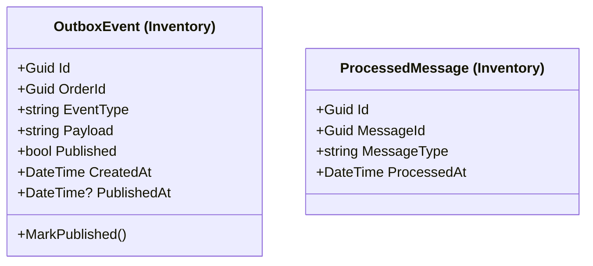
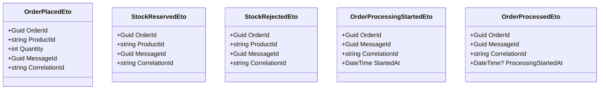

# Class Diagram

Domain entities and event contracts as they exist in code (checked by `scripts/verify-design-alignment.ps1`). Persistence mapping is in `docs/erd.md`, and event semantics are in `docs/event-contract.md`.

**Six-state model (implemented Week 11 box 2).** `OrderState` now has all six teacher states, the Process Worker publishes `OrderProcessingStartedEto`, and Order Service records every state change in `OrderStatusHistory`. `ProcessingFailed` is declared but unreachable (success-only Worker). All of these are drawn below, not listed as planned.

## Order Service (`src/FlashSale.OrderService/Entities`)

```mermaid
classDiagram
    class Order {
        +Guid Id
        +string IdempotencyKey
        +string ProductId
        +int Quantity
        +OrderState State
        +string CorrelationId
        +DateTime RequestAcceptedAt
        +DateTime? ConfirmedOrRejectedAt
        +DateTime? CompletedAt
        +TransitionTo(OrderState newState)
    }
    class OrderState {
        <<enumeration>>
        PendingStock
        Confirmed
        Rejected
        Processing
        Completed
        ProcessingFailed
    }
    class OrderStatusHistory {
        +Guid Id
        +long Seq
        +Guid OrderId
        +OrderState? FromState
        +OrderState ToState
        +Guid? MessageId
        +DateTime At
        +bool Implied
    }
    class OutboxEvent {
        +Guid Id
        +Guid OrderId
        +string EventType
        +string Payload
        +bool Published
        +DateTime CreatedAt
        +DateTime? PublishedAt
        +ForOrderPlaced(Order order)$
        +MarkPublished()
    }
    class ProcessedMessage {
        +Guid Id
        +Guid MessageId
        +string MessageType
        +DateTime ProcessedAt
    }
    class InvalidOrderStateTransitionException
    Order --> OrderState : State
    Order ..> InvalidOrderStateTransitionException : throws on illegal transition
    OrderStatusHistory ..> Order : OrderId (logical, same transaction)
    OutboxEvent ..> Order : OrderId (logical, same transaction)
```

## Inventory Service (`src/FlashSale.InventoryService/Entities`)

Separate classes from Order Service's classes with the same names; each service owns its own copy and its own schema.

## Event contracts (`src/FlashSale.EventContracts`)

| Event | Publisher | Consumer(s) |
|---|---|---|
| `OrderPlacedEto` | Order Service (Outbox) | Inventory Service |
| `StockReservedEto` | Inventory Service (Outbox) | Order Service, Process Worker |
| `StockRejectedEto` | Inventory Service (Outbox) | Order Service |
| `OrderProcessingStartedEto` | Process Worker | Order Service |
| `OrderProcessedEto` | Process Worker | Order Service |
